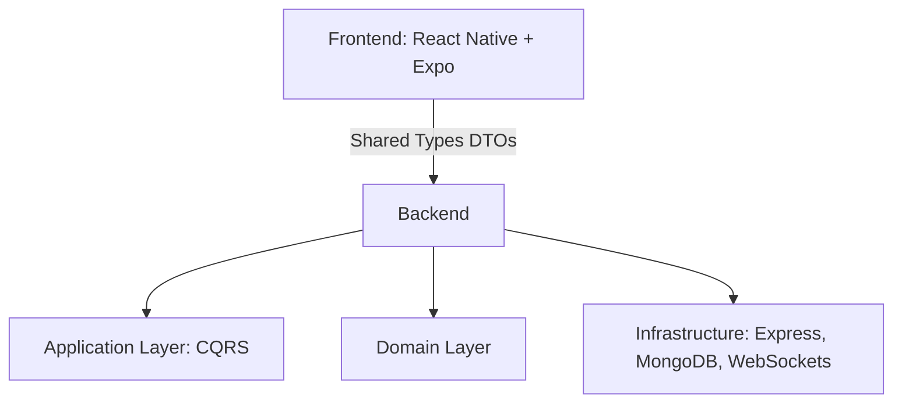

# Chat App — Full Stack Architecture Showcase

> A personal project focused on developing architectural thinking and 
> applying professional patterns. The source code is private.

---

## Why I Built This

I'm building a full-stack chat app as a personal project. It's organized as 
a monorepo, where backend and frontend share TypeScript types (like DTOs) 
to keep everything consistent across layers.

My purpose with this project isn't to deploy it (or maybe, who knows), but 
to develop architectural thinking and apply the patterns used in the 
professional tech industry. I use AI to help me make decisions and as a 
learning resource rather than to automate my development. I prefer writing 
the code end to end myself and having the mental model of every single line.

---

## Tech Stack

### Backend
- **Runtime:** Node.js
- **Framework:** Express
- **Language:** TypeScript
- **Database:** MongoDB
- **Auth:** JWT (authentication) + bcrypt (password hashing)
- **Real-time:** WebSockets

### Frontend
- **Framework:** React Native
- **Tooling:** Expo, Expo Router
- **Secure storage:** expo-secure-store

### Shared
- **Monorepo:** Backend and frontend share TypeScript types

### Planned
- Redis for caching (still evaluating alternatives)
- Mesh network communication (like Bluetooth) as an offline-first option
- AI integration

---

## Architecture

The backend is where the complexity is more challenging. I've been applying:

- **Clean Architecture** — separating domain, application, and infrastructure layers
- **CQRS principles** — separating reads from writes
- **Event-driven design** — domain events and handlers
- **Dependency injection** — decoupling implementations from contracts
- **Design patterns** — applied where they solve real problems, not for the sake of it

---

## Features (Current)

- ✅ User registration and login
- ✅ Password hashing with bcrypt
- ✅ JWT-based authentication
- ✅ Secure token storage with expo-secure-store
- ✅ Real-time messaging with WebSockets
- ✅ Shared TypeScript types across frontend and backend

## Features (Planned)

- ⏳ Redis caching (evaluating alternatives)
- ⏳ Mesh network communication (Bluetooth)
- ⏳ AI integration
- ⏳ Deploy (maybe)

---

## Key Decisions

**Why a monorepo?**
To share TypeScript types between backend and frontend, 
keeping contracts consistent and avoiding duplication.

**Why Clean Architecture + CQRS?**
Because the project has enough complexity to justify it. I wanted to 
practice separating concerns and designing for maintainability.

**Why WebSockets?**
Real-time communication is core to a chat app. It was also a chance to 
work with event-driven patterns in practice.

**Why AI as a learning tool, not a shortcut?**
I use AI to help me make decisions and as a learning resource, not to 
automate my development. I prefer writing the code end to end myself and 
having the mental model of every single line.

---

## Status

Work in progress. The source code is private, but this repository documents 
the architecture, decisions, and evolution of the project.

---

## Contact

- LinkedIn: www.linkedin.com/in/lucas-colman-833924210
